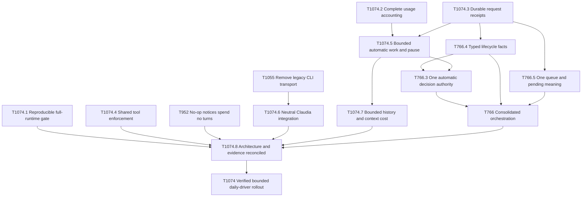

# Cleanup goal: 🎯T1074

**Jevons runs on a clean, bounded and verified Jevons–Claudia architecture suitable for a controlled daily-driver rollout.**

This is the single final target to set as a goal. Bullseye is the canonical dependency and acceptance record. This page is its navigation map, grounded in the [October audit](/Users/marcelo/work/github.com/marcelocantos/jevons/docs/audits/entropy-audit-2026-10-16.md).

Creating this graph does not start execution or resume the parked fleet. Execution stays local unless shipping is separately requested. Live verification uses bounded isolates; resuming the owner's development fleet is a separate explicit action.

## Graph

Arrows below mean **prerequisite → dependent**. Redundant transitive edges and the final target's direct umbrella edges are omitted for readability. All eight dotted children are hard dependencies of 🎯T1074 in Bullseye, alongside 🎯T766 and 🎯T952.

The existing achieved seat-observation and report-delivery prerequisites remain attached to 🎯T766. They are omitted from this diagram, not reset or discarded.

## Work and ownership

| Target | Desired outcome | Implementation home / reused work |
|---|---|---|
| 🎯T1074.1 | An attributable clean baseline, full-runtime gates and trustworthy attestation | Claudia gate/sidecar suite; Jevons integration tooling. Fixes the omitted Bun suite and false-clean attestation cases. |
| 🎯T1074.2 | Every provider request is accounted for exactly once, including summaries/retries | Sidecar emits facts; Claudia normalizes/persists; Jevons attributes. Reuses Claudia 🎯T2.4's local accounting scope without adding optional Admin Cost API work. |
| 🎯T1074.3 | Host-minted IDs, typed execution facts and durable receipts survive queueing, steering, retries and reconnect | Claudia protocol/broker/sidecar plus Jevons queue adapter. Reuses relevant 🎯T179/🎯T184/🎯T188/🎯T185 work. No transcript guessing and no silent loss of request identity. |
| 🎯T1074.4 | All provider tool entry points enforce the same seat grant | Claudia sidecar common execution policy, including Cursor native callbacks. |
| 🎯T1074.5 | Automatic work has durable allowances; pause prevents new requests/tools without losing work | Jevons mission/rate policy; Claudia admission; sidecar final invocation checks. Reuses 🎯T777 and 🎯T966 behavior, without making pause-button styling a cleanup prerequisite. |
| 🎯T1074.6 | Claudia is consumer-neutral and the authorized legacy transport is gone | Reuses Jevons 🎯T1055 and Claudia 🎯T160/🎯T177/🎯T189/🎯T192. No replacement CLI Task engine is required. |
| 🎯T1074.7 | Event/history handling has bounded overhead and explicit context economics | Claudia persistence/context/events; Jevons projections. Preserves canonical conversation and existing in-place switching. |
| 🎯T1074.8 | Architecture, gates, hygiene declarations and the evidence map describe the actual consolidated system | Both repositories. Independent review checks the production call sites and removal of replaced mechanisms. |
| 🎯T952, reused and strengthened | Known intentional holds cause zero model turns; actionable alerts have bounded durable delivery | Jevons notification producer/coalescing. Existing backoff WIP is evaluated, not presumed sufficient. |
| 🎯T766, reused | One observation authority, typed facts, one automatic decision authority and coherent queue semantics | Its existing children remain canonical. Typed facts and queue integration now consume 🎯T1074.3; automatic reconciliation consumes typed facts and 🎯T1074.5. |
| 🎯T1074, final | The integrated pair proves useful bounded orchestration through real provider-backed journeys | Consumes all of the above, including an owner request through overseer, PO, worker, result and accepted completion. |

The coordination graph lives in Jevons. This does not move Claudia implementation ownership into Jevons. Bullseye's cross-repository links are advisory, so the local integration nodes require actual evidence from both repositories instead of pretending that a cross-repository status reference is a hard completion gate. Reuse existing Claudia targets when implementing; do not create duplicate implementations or require their unrelated historical scope.

## Acceptance and scope

The final target requires exact verified Jevons/Claudia revisions, locked sidecar dependencies, clean hermetic gates and bounded live-provider evidence for changed paths. The pilot includes pause/resume, daemon/broker restart, provider switch, unavailable authentication, uncertain receipt and ineffective continuation. It proves useful completed work, durable obligations, measured resource use and no repeated no-action turns.

An infrastructure error or missing provider is an explicit outage, never a green. A passing helper, a DIRTY tree, a set-aside dependency, a smaller string census or a report claiming success cannot substitute for the final evidence. Accepted risk must be named and owner-approved. Independent implementation and oracle work may proceed concurrently; completion requires both together.

The graph preserves existing owner decisions:

- Jevons owns mission policy; Claudia owns generic per-seat execution contracts; sidecar owns context/provider/tool execution.
- The host mints logical RequestIDs. Claudia preserves them and owns execution receipts/attempt identity.
- Rate limiting defers new automatic work rather than killing an in-flight turn. Owner pause prevents new calls; in-flight work may finish.
- 🎯T766.3's explicit synchronous MCP/HTTP exceptions retain their safety guards and cannot become a second automatic planner. Its recorded watchdog scope remains intact.
- The authorized legacy purge includes CLI Task removal with a clear named failure; it does not wait for an unsolicited replacement engine.

The graph does **not** require new Pigeon/mobile/voice work, new owner-authentication architecture, Mnemo-wide summarization, resurrected handover agents, a new architecture coach, unrelated UI polish, release/publication, every historical target or an arbitrary long soak. 🎯T1054 retains its separate narrowed owner-output filtering scope; it is not repurposed into a request-authentication or metering project here.

Numerical owner-profile allowances and preferred context economics remain explicit policy choices. Test profiles declare their bounds before running; implementation must not infer production spend permission from the absence of a configured limit.

## Starting and finishing

Initially independent: 🎯T1074.1 (gates), 🎯T1074.2 (usage), 🎯T1074.3 (receipts), 🎯T1074.4 (tool enforcement), 🎯T952 (no-op notices), and 🎯T1055 (legacy retirement). They are parallel opportunities, not an instruction to start the whole fleet. Use a bounded number of workers and one integration owner when execution is activated.

The decisive final result is 🎯T1074's verified configuration and evidence packet. Child completion alone does not automatically certify it. The owner can then decide when to enable that bounded configuration on the development fleet.
