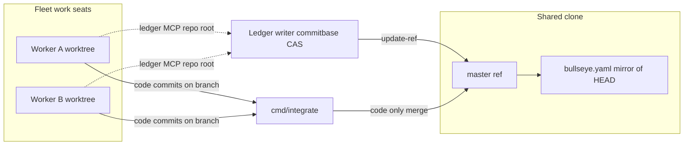

# Fleet shared state: design for 🎯T1151

Status: implementation landed 2026-10-23 (children 🎯T1151.1–🎯T1151.8 achieved). Owner approved 🎯T1151 ("Go for it").
Umbrella journey: J51-t1151-concurrent-fleet on the trust isolate; hermetic oracle TestT1151UmbrellaConcurrentWorkersIntegrateAndLedger.

## Problem statement

Tonight's incident cluster (2026-10-21/22) shares one root cause: **the Jevons product repo is one shared git working tree plus one `bullseye.yaml` that many actors mutate without a single serialization story**. Guards (🎯T1134, 🎯T1144, 🎯T1145, 🎯T1146, 🎯T1147, 🎯T1141) each patch one verb into that model. 🎯T1151 removes the shared **mutable** state by construction:

1. Fleet **work** seats write only inside their own worktree.
2. Every ledger mutation becomes **one commit** on the shared integration branch through **one writer**.
3. Worker branches carry **code only**; the integrator moves the shared branch.
4. Nothing a fleet seat runs may rewrite the shared work tree except the integrator and the ledger writer (owner exempt).

Related but **out of scope** for 🎯T1151: 🎯T541 (fleet-wide Cursor spawn/materialization regression, owner-reverted 2026-10-22) — same *class* of failure (shared spawn path broke everyone) but a different surface.

---

## Current architecture (observed)

### Repos and directories

| Path | Role |
|------|------|
| `cfg.WorkDir` (development: `…/marcelocantos/jevons`) | **Shared clone** — daemon default workdir, frontier ledger discovery, overseer/PO workdir, `bullseye serve` cwd for fleet MCP |
| `../.jevons-worktrees-jevons/<agent>` | Per-worker isolated trees (`jevons-worktree/<agent>` branches), 🎯T254.2 |
| `~/.jevons/` | Daemon state (agents, gates, reports) — must not be opened by isolate daemons (🎯T1141) |
| Homebrew `bullseye serve` (one process, all MCP clients) | HTTP MCP on `127.0.0.1:18743`; mutates `bullseye.yaml` under caller `--cwd` |

There are **many** linked worktrees (~57 at scout time); only a subset are fleet worker trees.

### Spawn paths and workdir resolution

Every path below ends in a registry `workdir` and a provider launch. **Today**, worktree isolation is conditional, not universal.

| Spawn path | Entry | Workdir source | Isolation today |
|------------|--------|----------------|-----------------|
| Frontier auto-spawn | `StartFrontierConsumeLoop` → `spawnFrontierWorker` → `stitchAgentStart` | `FrontierConsumeLoopArgs.Workdir` = **`cfg.WorkDir` (shared clone)** | Same as `agent_start` |
| PO / overseer `jevons_agent_start` | `handleAgentStart` | Caller `workdir` (expected: shared clone); `worktree.Ensure` when `NeedsIsolation` | **Only if** `purpose=work`, non-PO/boss/auditor/overseer/aside **and** (`Existing(workdir,name)` **or** `repoSharedWithWorker`) |
| Remint / resume | `stitchAgentStart` on existing row | Stored registry `workdir` | No migration |
| Daemon boot reattach | `ReattachSeatsContext` | **Stored** `AgentDef.WorkDir` from `agents.json` | No migration |
| `jevons_thread_spawn` | `butler.Spawn` | **Caller-supplied** `workdir` (required) | **None** — no `worktree.Ensure` |
| `jwork` | `handleJwork` | `cwd` arg or `s.workerWD` (daemon default) | **None** — ephemeral Grok subprocess, not a registry work seat |
| Cursor/Claude sidecar materialization | Broker + seat roots | Registry `workdir` from mint | File tools bound to seat root (why Claudia workers could not land in shared clone) |
| Owner / human editors | IDE, shell | Shared clone | Exempt from fleet guards |

**Key classifier** (`internal/worktree/worktree.go`):

- `NeedsIsolation(purpose, role, sharedWithLiveWorker)` is **false** for the first lone `work` agent on the shared clone.
- `repoSharedWithWorker` counts **registered** (not only alive) work agents sharing the repo via `worktree.SharesRepo`.

So frontier drip often leaves **one** auto worker on the shared clone until a second worker registers — matching the observed "9 of recent starts used `workdir=…/jevons`".

**🎯T1151.1 change (design):** for fleet-managed `purpose=work` agents in the product git repo, **always** `worktree.Ensure(sharedClone, name)` before register/launch — drop the `sharedWithLiveWorker` gate. PO/overseer/aside/auditor stay on shared clone **read-only** (🎯T125). `thread_spawn` and `jwork` either get the same policy or are explicitly excluded with a documented contract.

### Processes that touch shared git state or `bullseye.yaml`

| Actor | What it does | Commits? |
|-------|----------------|----------|
| **`bullseye serve` MCP** (`apply` / `commit` sugar) | Reads/writes **`bullseye.yaml` in process cwd** (working tree) | **No** — achievements sit dirty until someone commits |
| **`jevons_target_file`** | `bullseye commit --op track --cwd <abs>` | Depends on bullseye CLI (typically working-tree write) |
| **Owner gate / RSI / other `runBullseye` call sites** | Shell `bullseye … --cwd` | Same |
| **`cmd/integrate`** | `commit-tree` / merge onto shared branch; may union `bullseye.yaml` on conflict (🎯T1145 path) | **Yes** — moves shared ref |
| **`internal/ledgercommit`** (🎯T1147) | `git commit --only bullseye.yaml` after mutation | Yes, but **still assumes** dirty working tree |
| **`bin/commitbase` / `internal/commitbase`** (🎯T432) | Private-index scoped commit off HEAD | Yes — **no** working-tree stage source |
| **`scripts/restart-jevonsd.sh` / `buildsnap`** | Detached build worktree; install binary into **shared** `bin/` | Commits no; **mutates** shared tree files |
| **Fleet agents (hand landings)** | `git stash`, `merge`, `reset` in shared clone | Yes — **incidents** |
| **Git hooks** (`pre-commit`, `pre-merge-commit`, `commitscope`) | Refuse ledger shrink / merges | N/A |
| **`treeguard` / `bin/fleetgit`** | Refuse `git stash` from fleet seats when those guards actually run. Live: Claude treeguard PreToolUse hook. `bin/fleetgit` is not on fleet PATH (🎯T1315). | N/A |
| **Owner session** | Commits, resets, integrate | Exempt |

The shared **`bullseye serve` singleton** is the critical coupling: all seats share one server, but each MCP call names a **cwd**; the server edits that cwd's file in place.

---

## Target properties (by child)

| Child | Property |
|-------|----------|
| 🎯T1151.1 | No fleet **work** seat's writable root is the shared clone; every spawn path calls `worktree.Ensure` (or equivalent) for work agents |
| 🎯T1151.2 | Ledger mutations are **ref moves** on the integration branch via private-index CAS; shared `bullseye.yaml` is a **read-only mirror** of `HEAD` |
| 🎯T1151.3 | Worker branch diffs never include `bullseye.yaml`; `integrate` refuses ledger on branch |
| 🎯T1151.4 | Fleet seats cannot `commit`/`merge`/`reset`/`stash`/`checkout` the shared clone; only `integrate` + ledger writer move refs |

---

## Single-writer ledger design

### Decision: where the atomic writer lives

**Primary: bullseye** (ledger semantics, MCP API, `apply` CAS `base:` tokens, cross-repo portfolio).

**Jevons: fleet integration layer** — spawn cwd policy, proxy configuration, `integrate`, git guards, and the **reference git recipe** (`internal/commitbase`, transitional `internal/ledgercommit`).

**Reasoning:**

1. **Semantics belong in one place.** `bullseye apply` already defines partial updates, ID allocation, and CAS. Re-implementing that in Go forks the product.
2. **Jevons already shells out** for filing (`jevons_target_file` → `bullseye commit`). The fleet daemon is the natural place to enforce "all ledger writes go to **repo root** + **commit mode**," but not to own YAML merge rules.
3. **`commitbase` is the proven pattern** for "hot shared file" commits (🎯T432). Bullseye should adopt the same contract: read blob at `HEAD:bullseye.yaml`, apply op in memory, `commit-tree` + `update-ref` CAS retry — **never** read staging from the working tree.
4. **Transitional:** 🎯T1147's `ledgercommit` (`git commit --only`) is a band-aid that still leaves a dirty-tree window and races with integrate/reset. It should remain only until bullseye commit mode ships, then shrink to a thin wrapper or go away.

**Cross-repo filing:** file a bullseye-repo target (e.g. atomic commit mode for `serve` + CLI) and a Jevons target for daemon/seat routing. Scout does not mint IDs here.

### Writer protocol (normative)

1. **Integration branch:** `master` locally (🎯T104 — no push autopilot).
2. **Read:** `git show HEAD:bullseye.yaml` at branch tip (or open-repo equivalent for `bullseye open`).
3. **Apply:** in-memory op + optional CAS (`base:` hash of tip blob).
4. **Write:** `commitbase`-style private index → `commit-tree` → `update-ref` with retry on non-fast-forward.
5. **Worktree refresh:** after success, update shared clone's `bullseye.yaml` to match new `HEAD` (or `git checkout HEAD -- bullseye.yaml`) so **no durable dirty ledger**.
6. **Callers in worktrees:** MCP/`--cwd` may be the worker tree for **code**, but ledger RPCs must resolve **`RepoRoot`** to the shared clone and write only through the protocol above. Worktree copies of `bullseye.yaml` are read-only snapshots (from `HEAD` at last sync).

### `bullseye serve` fleet mode

For repos registered as fleet product repos (daemon config):

- `apply` / `commit` **always** use commit mode (no in-place save).
- Optional env: `BULLSEYE_INTEGRATION_REF=refs/heads/master`, `BULLSEYE_COMMIT=1`.
- Jevons MCP seat template sets these for the bullseye server entry (or a fleet-specific bullseye wrapper).

---

## Landing order (🎯T1151.1–4 without breaking the running fleet)

Order minimizes **in-flight** seats on the shared clone and stops **achievement loss** early.

| Phase | Target | Why this order |
|-------|--------|----------------|
| **1** | 🎯T1151.2 Atomic ledger writer | Stops the highest-frequency loss (dirty achievements wiped by reset/integrate/restore, 🎯T1147) **without** migrating every seat. Can ship bullseye commit mode + daemon routing behind a flag; existing worktrees keep working. |
| **2** | 🎯T1151.1 Universal worktrees | New spawns never touch shared checkout; existing shared-clone seats age out via reap/remint. Changes `NeedsIsolation` + frontier workdir prep. **Do not** mass-remint all 57 trees in one cutover. |
| **3** | 🎯T1151.4 Shared clone git guards | Completes ref-move/refuse story for seats still on shared clone during transition; covers `reset` (04:30:50 incident). Owner exempt. |
| **4** | 🎯T1151.3 No ledger on worker branches | Safe once ledger writes bypass worker trees. Remove 🎯T1145 mechanical union from `integrate` (keep refusal path). |

**Parallelism:** Phase 1 bullseye work can proceed in the bullseye repo while Phase 2 starts in Jevons. Phase 4 must follow 1+2.

**Daemon bounce:** React/UI changes are not required for 1–2; a development daemon restart picks up spawn routing. No `SIGSTOP` on jevonsd (🎯T1067).

---

## Incident map → removing property

| Incident | What happened | Guard today | **Property that removes it** |
|----------|---------------|-------------|------------------------------|
| **🎯T1134** (stash land) | Worker `git stash push` in shared clone; stole 🎯T1133 dirty row; merge truncated ledger | `fleetgit`/treeguard stash refuse; integrate refuses overlapping dirty paths | **🎯T1151.1** (worker not in shared tree) + **🎯T1151.4** (fleet cannot stash/merge shared) + landing **only** via `integrate` |
| **🎯T1144** (merge truncation) | Merge commits with ~100KiB clobbered `bullseye.yaml` (partial read/write under load) | `pre-merge-commit`, integrate shrink refuse | **🎯T1151.2** (ledger not merged via git text merge) + **🎯T1151.3** (branches don't carry ledger) |
| **🎯T1145** (hand-resolve union) | Workers hand-resolved `bullseye.yaml` from truncated read; ef5fdf35 / 08a69a88 | Integrate union path + "never hand-resolve" doctrine | **🎯T1151.3** (no ledger on branches → **no conflict**) |
| **🎯T1146** (workspace gate) | Integrate landed `go.mod` replace to sibling; pristine gate failed | Pristine gate + replace refuse (achieved) | **🎯T1151.1** (build in real worktree; `MirrorGoWork` policy explicit) — guard kept as belt |
| **🎯T1147** (lost achievements) | Achievements only in dirty working yaml; 04:29:02 wholesale rewrite; restore from old base dropped rows | `ledgercommit`, preserve-on-restore, treeguard restore refuse | **🎯T1151.2** (achieve = commit immediately; no long-lived dirty rows) |
| **🎯T1141** (isolate daemon) | Worktree `jevonsd` opened production `~/.jevons` + broker | Journey env vars | **Not 🎯T1151** — state-dir / broker isolation (sibling). Mention: hand-started daemons must not share production state. |
| **04:30:50 `reset: moving to 9c829f83`** | Fleet process reset shared checkout during 🎯T1140 landing | Partial | **🎯T1151.4** (refuse fleet `git reset` on shared clone) + **🎯T1151.2** (achievements already committed, not in working file) |
| **🎯T541** (spawn outage) | Shared materialization path regression | Reverted by owner | Out of scope; illustrates **fleet-wide shared-path** risk |

---

## Spawn / write flow (target)

---

## Re-slice recommendations (blindspots)

Before implementation, consider filing or adjusting children:

1. **🎯bullseye/T…** (new): `serve` + CLI **commit mode** using private-index CAS (API + hermetic concurrency test). Blocks full 🎯T1151.2 acceptance.
2. **Split 🎯T1151.1** optional slice: `thread_spawn` + `jwork` cwd policy (explicitly isolate or ban product-repo writes).
3. **🎯T1151.2 ↔ 🎯T1147**: once commit mode ships, retire or narrow `ledgercommit` / preserve-merge shims so two writers don't fight.

---

## Fog register (scout)

### fog-known

- Frontier and `agent_start` share `stitchAgentStart` + `worktree.Ensure` conditional on `NeedsIsolation`.
- `integrate` already supports ledger union and shrink refusal (`internal/worktree/integrate.go`).
- `commitbase` and `ledgercommit` exist in Jevons as git recipes.
- Sidecar seat roots already block out-of-tree file tools for Cursor/Claude.
- `bullseye apply` supports CAS `base:` for optimistic concurrency.

### fog-unknown

- Exact bullseye `serve` code path for in-place save (bullseye repo not in this worktree); assumed working-tree write from product behavior.
- Identity of the **04:29:02** wholesale `bullseye.yaml` rewriter (reflog shows merge/commit/reset cluster; no single attributed process in Jevons tree).
- Full inventory of **non-fleet** writers (owner IDE, `bullseye import`, human `git commit --only`) under commit mode — need explicit owner exempt + UX.
- `MirrorGoWork` / `GOWORK` behavior for all providers after universal worktrees.

### fog-blindspot

- **Cross-repo portfolio** (`bullseye portfolio`, multi-repo ledgers): commit mode must be per-repo but portfolio reads may need new consistency story.
- **57 existing worktrees**: migration policy for stale `jevons-worktree/*` branches with embedded ledger commits from pre-🎯T1151.3 era (one-time audit vs refuse integrate).
- **Third-party bullseye MCP clients** outside Jevons seats (owner session, CLI) bypassing fleet routing unless `serve` enforces commit mode globally.

---

## Acceptance traceability

This note satisfies 🎯T1151.5 when:

- Spawn paths and workdir sources are enumerated (above).
- Shared-git / `bullseye.yaml` writers are enumerated (above).
- Ledger writer home decided (**bullseye semantics + Jevons fleet routing / commitbase recipe**).
- Landing order for 🎯T1151.1–4 listed (above).
- Incidents mapped to properties (table above).

Implementation remains in 🎯T1151.1–4; umbrella 🎯T1151 journeys after children achieve.
